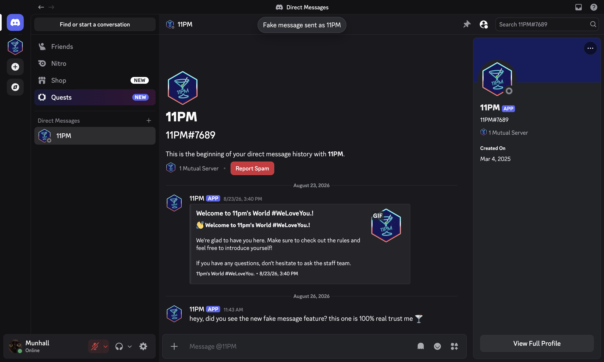
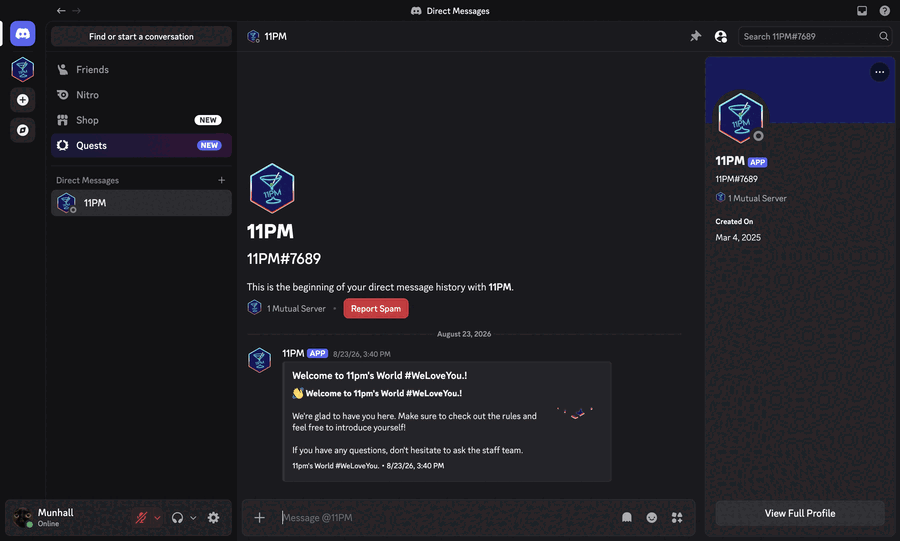
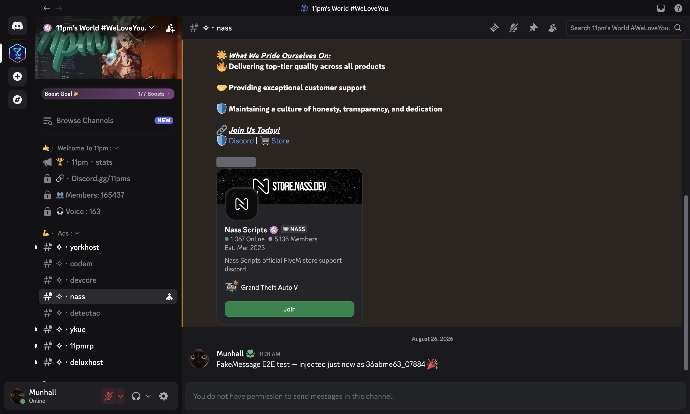

# 👻 FakeMessage

> Fake messages that look **100% real** — rendered by Discord itself.

FakeMessage is a [Vencord](https://github.com/Vendicated/Vencord) plugin that drops messages into any channel **as if another user had sent them** — with their real avatar, username, role color, and timestamp. The message never leaves your client, but it is rendered by Discord's own message component, so it is visually and interactively indistinguishable from a genuine message.

## Demo

Watch the whole flow: click the 👻 button, search for who should have sent it, type, and hit **Insert** — the fake lands in the chat, and right-clicking it offers **Remove Fake Message**.

## Features

- **👻 Chat bar button** — a ghost button at the left of the message input. Click it, search for the person who should appear to have sent the message, type, and hit **Insert**. Shown by default; hide it anytime via **Show chat bar button** in plugin settings.
- **🎯 `fakemessage` command** — `/fakemessage user: @bob content: hey check this out` drops the fake in the current channel. `minutes-ago` backdates it into history.
- **🖱 Context menus** — right-click any user → **Fake Message** (pre-selected for you); right-click a fake message → **Remove Fake Message**.
- **⏱ Backdating** — the fake slots into history at the right position with the matching timestamp.
- **💾 Persistence** — fakes survive restarts and channel switches (stored in plugin settings, toggleable).
- **🔒 Client-side only** — nothing is uploaded, synced, or sent. Nobody else sees your fakes.

## How it looks

Real avatar, real username, real role color, real timestamp, markdown, `<@mention>` highlighting, bot tags, and automatic grouping with the same author's real messages — all rendered by Discord's own CSS because the fake is injected into the real message store.

## Install

1. Copy the `FakeMessage` folder into `Vencord/src/userplugins/`.
2. Rebuild Vencord (`pnpm build` or your dev watcher).
3. Restart Discord, then enable **FakeMessage** under **Settings → Vencord → Plugins**.

## Usage

| Way | How |
| --- | --- |
| Ghost button | Click the 👻 button in the chat input bar → search a user (or paste a user ID) → type → **Insert**. Hidden/restored via **Show chat bar button** in plugin settings |
| Command | `/fakemessage user: <user> content: <text> [minutes-ago: <n>]` |
| User context menu | Right-click any user → **Fake Message** |
| Clean up | Right-click a fake message → **Remove Fake Message**, or Settings → **Clear all fake messages** |
| Hide the button | Turn **Show chat bar button** off in plugin settings — `/fakemessage` and the context menus still work |

## How it works

`MessageStore.getMessages(channelId)` is wrapped in a Proxy that merges the channel's real messages with any stored fakes, sorted by timestamp. Each fake is built by **cloning a real `Message` record** (same prototype, every field) and swapping in the real `User` object, new content, and timestamp — so Discord's renderer can't tell the difference. The underlying store is never mutated, so nothing ever syncs to Discord's servers.

## Privacy

- Everything stays on your machine in Discord's local settings storage.
- Fake messages are visible **only to you**. Other people never see them, and Discord's servers never receive them.
- The fakes are not real: replying to or editing one hits Discord's API and fails harmlessly. Use **Remove Fake Message** to clean up.

## Known limitations

- Links in fakes don't auto-fetch embeds (Discord only embeds messages it received from the server).
- No attachments / reactions / stickers — text, markdown, and mentions only.
- Fakes don't move the unread divider or notify anyone (they're client-side).

## License

[GPL-3.0-or-later](LICENSE) — same as Vencord.
